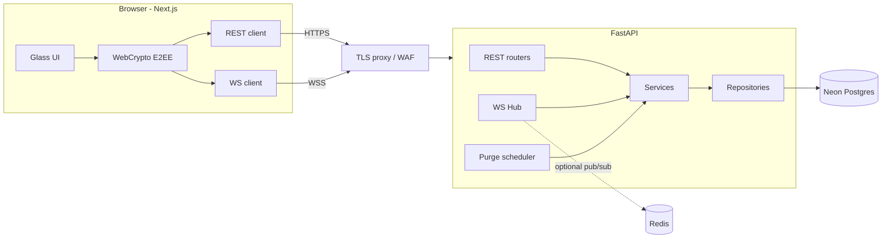
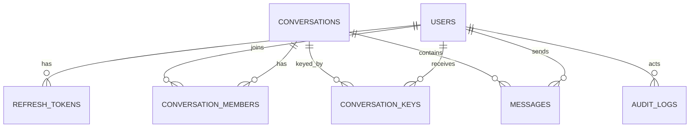
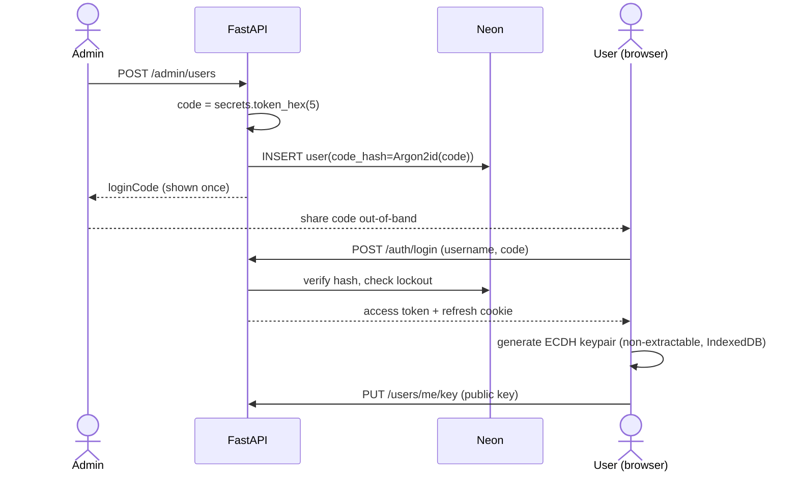
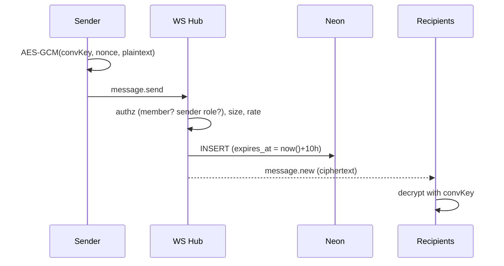
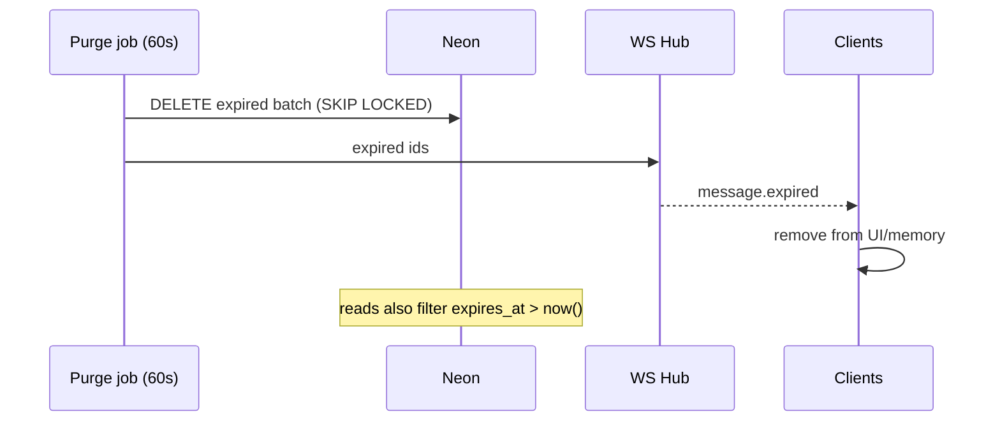

# System_Design.md — VaultChat (HLD + LLD)

## Project Context
- **Project name:** VaultChat (placeholder)
- **One-line description:** Invite-only, end-to-end encrypted chat with admin-controlled accounts and 10-hour auto-expiring messages.
- **Target users:** Private teams/communities managed by admins.
- **Core features:** Admin-only user creation with hex login code; 1:1, group and broadcast chat; E2EE; 10 h auto-clear.
- **Expected scale (assumed):** ≤ 5,000 users, ≤ 1,000 concurrent WebSockets, ≤ 50 msg/s peak, ≤ ~2 M live message rows (10 h window).
- **Tech stack:** Next.js 15 + Tailwind CSS; FastAPI + native WebSockets; Neon Postgres.
- **Constraints:** Small team, security-first, low latency, no plaintext on server.

## 1. Overview
**Purpose:** Private, closed, ephemeral messaging where the server cannot read content.
**Goals:** closed membership; E2EE; hard 10 h retention; real-time (<300 ms p95); glass/3D UI.
**Non-goals:** public sign-up, attachments, calls, search, message editing, forward secrecy (MVP), moderation of content (impossible under E2EE).

## 2. Requirements
**Functional:** see PRD §7.
**Non-functional**
| Attribute | Target |
|---|---|
| Latency | p95 send→receive < 300 ms; REST p95 < 150 ms |
| Availability | 99.5% MVP |
| Security | ASVS L2; ciphertext-only server; Argon2id; rate-limited auth |
| Scalability | 1k WS/instance; horizontal via Redis pub/sub |
| Retention | Rows deleted ≤ 60 s after `expires_at` |

## 3. Assumptions & Constraints
- Single region deployment; Neon in same region as backend.
- Users have modern browsers with WebCrypto + IndexedDB.
- Hex code delivered by admin out-of-band (secure channel).
- Code is 10 hex chars (40 bits) → security relies on rate limiting/lockout + Argon2id; optional passphrase recommended.
- One active device key per user (new login on new device rotates key).
- Admin is trusted to distribute codes but **cannot read messages**.

## 4. High-Level Architecture
**Style:** Modular monolith (single FastAPI deployable with clear modules). *Why:* small team, minimal latency/ops, easy to split later.



## 5. Component Design
| Component | Responsibility | Interfaces | Depends on | Tech |
|---|---|---|---|---|
| Web UI | Pages, state, rendering | REST, WS | Crypto lib | Next.js, Tailwind, Zustand, TanStack Query |
| Crypto lib | Keygen, wrap/unwrap, encrypt/decrypt | `encrypt(convId, text)` / `decrypt(msg)` | WebCrypto, IndexedDB | TypeScript |
| Auth service | Login, tokens, lockout, TOTP | `/auth/*`, `/admin/auth/*` | DB, argon2-cffi, PyJWT, pyotp | FastAPI |
| User admin service | Create/reset/disable users | `/admin/users*` | Auth, audit | FastAPI |
| Chat service | Conversations, members, history | `/conversations*` | DB | FastAPI |
| WS hub | Connections, fan-out, per-event authz | `/ws` | Chat service | Starlette WS |
| Purge service | Delete expired rows/tokens/keys | internal (60 s) | DB | asyncio / APScheduler |
| Audit service | Append-only admin/security log | internal | DB | SQLAlchemy |
| Rate limiter | Per-IP/per-user limits | middleware/deps | memory (or Redis) | custom / slowapi |

## 6. Data Design

- **DB choice:** Neon Postgres — managed, serverless, pooled, relational integrity for membership/authz, `bytea` for ciphertext. Full schema: database.md.
- **Indexing:** `(conversation_id, created_at DESC, id)`, `(expires_at)`, `(user_id)` on members.
- **Caching:** Not needed for MVP; in-memory LRU for membership lookups (30 s TTL) in WS hub.
- **Retention:** messages 10 h (DB-enforced default + purge); refresh tokens at expiry; old key versions 10 h after rotation; audit logs 90 days (no content).

## 7. API Design
Base `/api/v1`, JSON, versioned by path. Auth: `Authorization: Bearer <access>`; refresh via cookie.

**Create user (admin)**
```http
POST /api/v1/admin/users
{ "username": "rahul_01", "displayName": "Rahul" }
→ 201 { "id": "…", "username": "rahul_01", "loginCode": "a3f09c1b7e" }   // shown once
```
**User login**
```http
POST /api/v1/auth/login
{ "username": "rahul_01", "code": "a3f09c1b7e" }
→ 200 { "accessToken": "…", "user": {…}, "needsKeySetup": true }   // + Set-Cookie refresh
```
**Register public key**
```http
PUT /api/v1/users/me/key
{ "publicKey": "<base64 SPKI>" }  → 204
```
**Create conversation**
```http
POST /api/v1/conversations
{ "type":"group","name":"Team","members":[{"userId":"…","wrappedKey":"…","wrapperPub":"…"}] }
→ 201 { "id":"…","currentKeyVersion":1 }
```
**WebSocket events** (`wss://…/ws?ticket=…`)
```json
// client → server
{ "t":"message.send","conversationId":"…","ciphertext":"<b64>","nonce":"<b64>","keyVersion":1 }
// server → clients
{ "t":"message.new","id":"…","conversationId":"…","senderId":"…","ciphertext":"…","nonce":"…","keyVersion":1,"createdAt":"…","expiresAt":"…" }
{ "t":"message.expired","ids":["…"] }
{ "t":"key.rotated","conversationId":"…","keyVersion":2 }
```
Errors: `{ "error": { "code": "RATE_LIMITED", "message": "…" } }`.

## 8. Key Workflows
**8.1 Admin creates user → first login**

**8.2 Send encrypted message**

**8.3 Auto-clear**


## 9. Scalability & Performance
| Bottleneck | Mitigation |
|---|---|
| WS connections | uvicorn workers; per-instance 1k; sticky LB |
| Multi-instance fan-out | Redis pub/sub channel per conversation (Phase 11); *not* Neon LISTEN/NOTIFY (breaks under pooler) |
| History reads | Composite index + keyset pagination |
| Purge cost | Batched deletes, `expires_at` index; optional daily partitions later (drop partition = O(1)) |
| Neon cold start | Keep-alive ping; pooled endpoint; retry on connect |
| Auth hashing CPU | Argon2id params tuned (~100 ms); run in threadpool; rate limit protects CPU |

## 10. Reliability & Fault Tolerance
- **WS drops:** client reconnect (backoff+jitter), fetch missed messages by cursor.
- **Purge lag/crash:** read filter guarantees correctness; startup catch-up purge.
- **DB failover:** Neon HA; retries with idempotent message IDs (client-generated UUID).
- **Backups:** Neon PITR window set **as short as plan allows** (message ciphertext in backups outlives 10 h otherwise); ciphertext only, so exposure is limited. Document this.
- **SLA:** 99.5% MVP; RTO 1 h, RPO 5 min.

## 11. Security
| Area | Design |
|---|---|
| User auth | username + 10-hex code → Argon2id; 5 tries/15 min per user & IP; progressive lockout; generic errors |
| Admin auth | ≥24-char admin code + TOTP; separate endpoint; optional IP allow-list |
| Sessions | 10 min JWT (memory) + 7 d rotating refresh cookie (HttpOnly/Secure/Strict), reuse detection |
| WS auth | one-time 30 s ticket; per-event membership authz |
| E2EE | ECDH P-256 (non-extractable) → HKDF → AES-256-GCM; per-conversation key wrapped per member; key rotation on member removal; key fingerprints shown for verification |
| Transport | TLS 1.2+/HSTS, WSS only |
| Web | strict CSP, no inline JS, text-only message rendering, CORS allow-list |
| Secrets | env/secret manager; no secrets in repo; `TOTP_ENC_KEY` encrypts TOTP secrets |
| Logging | no bodies/tokens/codes; audit log for admin + failed logins |
| Abuse | message ≤ 8 KB; 20 msg/10 s; max group size (e.g., 200) |

**Threat model (summary)**
| Threat | Mitigation |
|---|---|
| Server/DB compromise | Only ciphertext; no keys in plaintext; hashed codes/tokens |
| Brute-force hex code | Rate limit + lockout + Argon2id + audit alerts; recommend passphrase |
| XSS stealing keys | non-extractable keys, strict CSP, in-memory tokens |
| Malicious/curious admin | Cannot read messages; actions audited. *Can* reset codes (and thus impersonate by re-enrolling) → fingerprint-change warning shown to contacts |
| Metadata leakage | Server sees who/when/size; documented limit |
| Replay/tamper | AES-GCM auth + AAD (conversationId, senderId, keyVersion) |
| No forward secrecy | Static keys; 10 h TTL limits blast radius; Double Ratchet in future |

> No system is "non-hackable"; this design targets defence-in-depth with a clearly stated threat model.

## 12. Infrastructure & Deployment
- **Envs:** local, staging, prod (Neon branches).
- **Containers:** Dockerfile per service; backend behind Caddy/Nginx (TLS, WS upgrade, rate limit).
- **Frontend:** Vercel or container.
- **CI/CD:** GitHub Actions — lint, types, tests, `pip-audit`, `npm audit`, gitleaks, build, deploy.
- **IaC:** Terraform/Pulumi (later); env via secret manager.
- **Logging/monitoring:** structured JSON logs (scrubbed), Sentry (scrubbed), uptime check on `/healthz`.

## 13. Observability
| Type | Items |
|---|---|
| Metrics | active WS, msgs/s, p95 latency, login failures, lockouts, purge lag, DB pool use |
| Logs | request-id correlated; auth events; purge counts |
| Traces | OpenTelemetry on REST + DB (sampled) |
| Alerts | login-fail spike, purge lag > 5 min, WS error rate, 5xx > 1%, admin login from new IP |

## 14. Trade-offs & Alternatives
| Decision | Options | Chosen | Rationale |
|---|---|---|---|
| Architecture | Microservices / Monolith | Modular monolith | Small team, low latency |
| Real-time | Raw TCP sockets / Socket.IO / native WS | Native WS | Browser-compatible, no extra layer |
| E2EE protocol | Signal Double Ratchet / static ECDH + AES-GCM | Static ECDH + AES-GCM | Simpler for MVP; TTL limits exposure; ratchet later |
| Group keys | Pairwise encrypt per recipient / shared key wrapped per member | Shared key wrapped | O(1) encrypt per message |
| Login | Hex code only / username+code | username+code | Avoids global code search; per-account lockout |
| Retention | Cron only / TTL index / expires_at + job + filter | expires_at + job + filter | Correctness + cleanup |
| Fan-out | LISTEN/NOTIFY / Redis | Redis (when scaling) | Works with pooled Neon |
| Token storage | localStorage / cookie+memory | cookie + memory | XSS resistance |

## 15. Risks & Open Questions
| Risk | Impact | Mitigation |
|---|---|---|
| 40-bit code guessed | Account takeover | Lockout, rate limits, optional passphrase, longer code option |
| Lost device = lost keys | Can't read history | Acceptable with 10 h TTL; admin re-enrol |
| Neon backups retain ciphertext > 10 h | Retention expectation | Shortest PITR, document |
| Browser E2EE trust (JS delivered by server) | Malicious JS risk | CSP, SRI, signed releases; native client later |
| Clock skew | Early/late expiry | DB-time only |

**Open questions:** see memory.md (group creators, passphrase, hosting, colours, "one to many" meaning).

## 16. Roadmap / Phases
- **MVP:** Phases 1–9 (setup → UI → DB → auth → admin → crypto → messaging → TTL → dashboards).
- **Hardening:** Phase 10–12 (security tests, optimisation, deployment).
- **Later:** Double Ratchet/forward secrecy, encrypted attachments, multi-device, read receipts/typing, push notifications, mobile app, configurable TTL.

## 17. Appendix
**Glossary:** *E2EE* end-to-end encryption; *ECDH* elliptic-curve Diffie-Hellman; *HKDF* key derivation; *AES-GCM* authenticated encryption; *TTL* time-to-live; *TOTP* time-based one-time password; *Argon2id* memory-hard password hash.
**References:** W3C WebCrypto API; OWASP ASVS & Cheat Sheets (Authentication, Session, WebSocket); RFC 5869 (HKDF); NIST SP 800-38D (GCM); Neon docs (pooling); FastAPI WebSocket docs.
